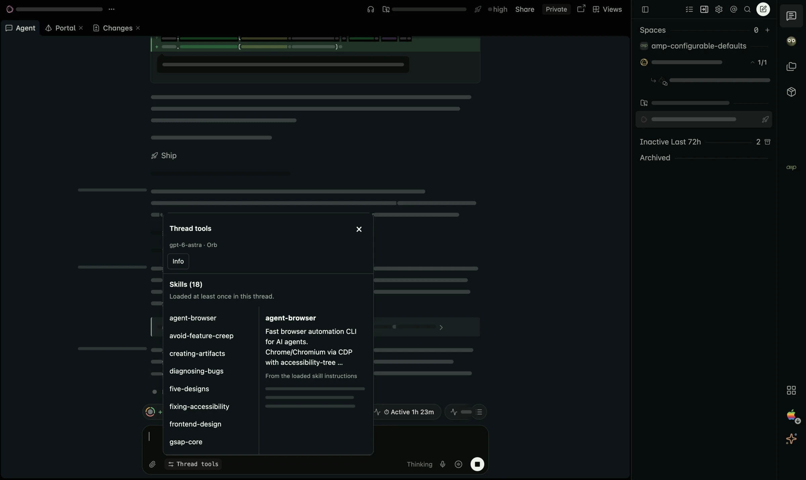
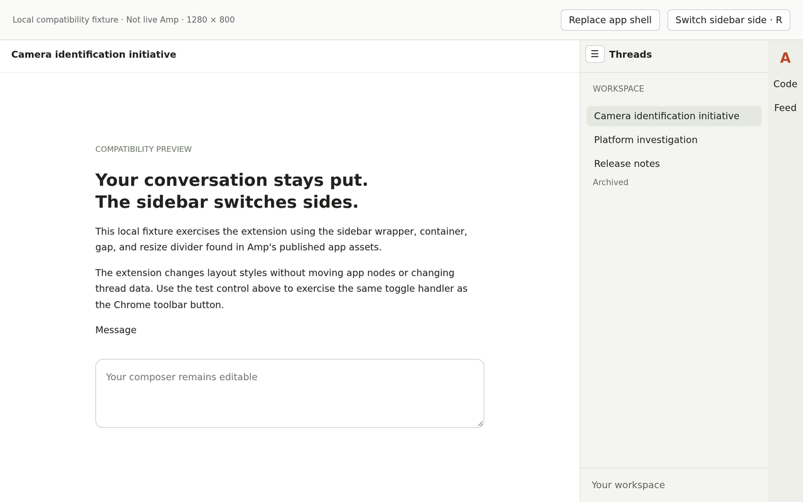
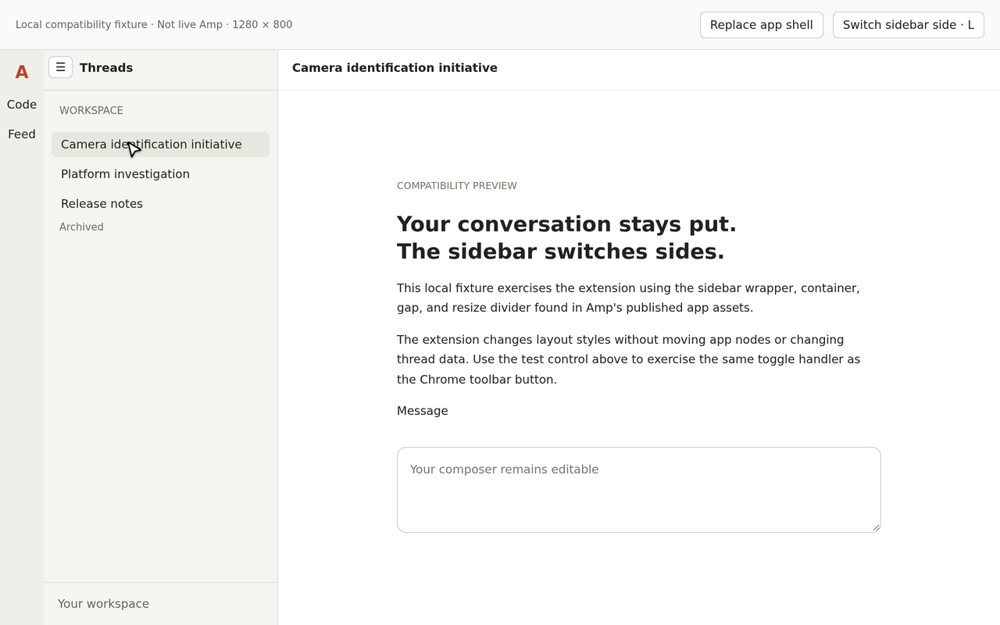

# amp configurable defaults

A dependency-free Chrome Manifest V3 extension for `https://ampcode.com`.
The desktop sidebar starts on the right. Click the extension's toolbar button
to open a compact settings popup. The R/L badge shows the saved side. The
choice applies to all open Amp tabs and survives browser restarts.

Independent project, not affiliated with or endorsed by Amp. The code is MIT licensed.

**Current public release: 1.4.1**, updated November 6, 2026 on the
[Chrome Web Store](https://chromewebstore.google.com/detail/amp-configurable-defaults/hpobhiphbifcjhplkegebmpiehkcpjod).
**Source and next package: 1.4.2**, not yet publicly released. This README
describes the source version, including changes not in the store package.
See the [release status, changes, and submission checklist](store/RELEASE.md).



_Live, signed-in Amp in Helium, October 26, 2026. Conversation, thread names,
and project names are redacted._

The [landing page](docs/index.html) explains the features and local installation.
Serve the repository with a static server and open `/docs/` to preview it.
The page has no build step, external fonts, or third-party scripts.
See [GitHub Pages deployment](#github-pages-deployment) to publish the existing
site directly from `docs/`. Hosting is not enabled by these files alone.

## Install locally

These steps install the unreleased 1.4.2 source. For the current public 1.4.1
release, use the Chrome Web Store link above.

1. [Download the source ZIP](https://github.com/Tyru5/amp-configurable-defaults/archive/refs/heads/main.zip),
   clone this repository, or build a packaged ZIP below.
   **Extract the ZIP** to a permanent folder. Do not select the ZIP in Chrome.
2. Open `chrome://extensions` in Chrome.
3. Turn on **Developer mode**.
4. Click **Load unpacked** and select the extracted folder that directly
   contains `manifest.json`. You can also load this cloned repository folder.
5. Pin **amp configurable defaults** from Chrome's Extensions menu.
6. Refresh any Amp tabs that were already open.

Click the pinned icon to change sidebar placement or any other feature in the
popup. Choose **Open settings in a tab**, or right-click the icon → **Options**,
for the full settings page. Both views share the same saved preferences.
Drag the divider to resize the right
sidebar, or double-click it to restore Amp's width. Left mode restores Amp's
native layout and resize behavior. Right-mode width is saved separately.
In right mode, auxiliary views such as Files, Changes, Terminal, Desktop, and
Portal open to the left of the conversation. Their dividers still resize in
the direction you drag. Left mode restores their native placement on the right.

Drag a sidebar thread to the left or right edge of the conversation to open it
in a second pane **inside the same Amp page**, not the browser's Split View.
Or focus a thread and press **Alt+Shift+Left/Right**. Drag the divider to resize,
use its arrow keys, or double-click to reset. Dragging the same thread to the
other edge moves its pane without reloading it. Close the current split before
opening a different thread. Closing or reloading ends the split; it is not saved.
Existing panes stack vertically below 768px; new splits require desktop width.
The embedded page uses your Amp session and its native composer. See the
[security exception](PRIVACY.md#embedded-thread-security-exception) before using it.

Child thread rows are indented by 20px per level on either side, up to 64px,
using Amp's existing parent-child hierarchy without reordering threads.
The **right-sidebar arrow icon** in Amp's sidebar header switches placement,
just like **Move sidebar to the right** in the popup or **Options**.
These controls stay synchronized across open Amp tabs and preserve other feature
choices and your saved right-side width. There is no master feature switch.
The obsolete `enabled` preference from older versions is ignored.

In the thread composer, to the right of the upload button, a compact label shows
the model the thread is using and where it runs: the runner name for local
threads, or **Orb** for cloud threads. Hover it for the mode and directory. The values come from the same thread data Amp's
page loads, fetched from `ampcode.com` with your existing session. It refreshes
on thread changes and at most once a minute while the tab is visible. Before
the first reply, it shows the thread's mode until a model is known. External
agents show **Model unavailable** when the data does not identify a model,
with the agent mode still available on hover. Their cloud executor is **Orb**.
When the thread has an explicit effort setting, the label includes it beside
the model, for example **high effort**. Missing effort is omitted, not inferred
from the mode name.

Hovering or keyboard-focusing a thread in the right sidebar opens Amp's native
thread information card to its left. Amp still owns the content and dismissal.

A thread info control sits in the composer toolbar, first among the extension's
controls after the model and runner label. Click it to open a popover with the
thread title, executor, project, mode, and visibility from Amp's title bar,
including details Amp hides at narrow widths. The card also shows the runner and
working directory when available from the same thread data used by the composer
label, even when that label is disabled. Click again, press Escape, or click
elsewhere to close it. On a read-only thread without a composer, the control
sits in the title bar. Desktop only.

Skills successfully loaded in the thread appear above the desktop composer toolbar.
Repeated loads appear once; failed loads and nested subagent activity are excluded.
Hover or focus a skill for an excerpt from its instructions and its location when
available. Clicking opens Amp's Skills settings in a new tab, preserving the draft.
Older transcript pages and Amp's collapsed-turn skill summaries are included.
If history cannot be fully read, the count has a `+` and the tools panel explains
what is missing. Summaries may identify a skill without including its instructions.

When the skill names or toolbar controls no longer fit, the extension folds its
controls and model/runner label into **Thread tools**. Clicking it opens a popover
above the button, left-aligned with it like the Info and Messages popovers, without
dimming or blocking the thread. Click again, click elsewhere, use its close button,
or press Escape to close it. **Skills** opens the same popover in the roomy layout.
The panel lists all skills and opens the existing Info, Subagents, and Messages
panels. Amp's attachment and send controls stay available. Resizing restores the
full layout when it fits.
Counts use parentheses, for example **Skills (4)** and **Subagents (2)**.

These features have independent checkboxes in **Options**:

| Setting                                   | Default | When off                                                          |
| ----------------------------------------- | ------- | ----------------------------------------------------------------- |
| Move sidebar to the right                 | On      | Native left sidebar; also controlled by the sidebar header switch |
| Resize and remember right-sidebar width   | On      | Native width, no right resize handle; saved width retained        |
| Keep auxiliary views opposite the sidebar | On      | Native view placement and divider input                           |
| Indent child threads                      | On      | Native row spacing on either side                                 |
| Show placement switch in sidebar header   | On      | No injected placement switch; use Options or the toolbar icon     |
| Enable subagent reading panel             | On      | No Subagents control; native inline activity; removes any open panel |
| Enable thread message panel               | On      | No thread-message control; native messages stay unchanged          |
| Show model and runner in the composer     | On      | No composer label; thread info can still load data                |
| Show thread info in the composer          | On      | No thread info control; title-bar details stay in Amp's title bar |
| Show skills used in the composer          | On      | No skills list or skills history requests; other controls still fold when crowded |
| Fade long tool-call sections              | On      | All tool rows and complete Bash commands are shown without fading |
| Show full dates in message timestamps     | Off     | Amp's time-only timestamps                                        |

**Show full dates in message timestamps** adds the calendar date, including the
year, in front of the `HH:MM:SS` time Amp shows above each message. Amp shows
those times with its own **Always Show Timestamps** setting or while you hold
Option or Alt; this extension no longer keeps times visible itself. The date is
the one Amp's displayed time falls on, derived from the message's timestamp
without any extra request. Turning it off restores Amp's time-only display.

Feature choices remain editable and active with either sidebar placement.
Custom resizing applies only in right mode; left-side resizing stays native.
Amp's existing collapse/expand controls remain available
and follow sidebar placement. The subagent panel works on either side, independently
of auxiliary-view placement, and starts closed after being re-enabled.

Subagent activity always has a compact inline summary. Click it to expand the
original Amp content, including when the optional panel is disabled or on mobile.
Running and delegated agents have a gently pulsing status dot; completed,
failed, and cancelled agents do not. Reduced motion keeps the active dot static.
Tool-call summaries and individual tool headers use tinted rows with a left
border to distinguish execution activity from assistant prose.
With **Fade long tool-call sections** enabled, loaded status sections with more
than five tool-call rows start with a preview of the first five, fading from top
to bottom. Turn it off in Options or the toolbar popup to show all rows immediately.
Click anywhere in the preview or
on its status header to reveal the whole section. The preview button also works
with Enter or Space. Individual output disclosures stay closed until opened.
Bash commands render as code blocks in both previews and expanded sections,
preserving the full text, line breaks and indentation. With fading enabled,
commands taller than eight displayed lines, including wrapped lines, start with
a bounded preview. **Show full command** reveals the rest; **Show less** collapses
it again. Both work with Enter or Space without opening the command's output.
This also applies to standalone Bash calls and sections with five or fewer rows.
Command expansion is kept on the current row, not in storage.
Turning fading off shows complete commands as well as all tool rows.
Read, Grep, and List activity summaries use the same block style, including file
line ranges and full search patterns, even when they have no expandable output.
These blocks show Amp's summary text, not reconstructed shell commands, and are
not subject to the eight-line Bash limit.
Section expansion is remembered while viewing the thread, including when rows
remount, and resets on navigation or reload. This applies on both sidebar sides
and at mobile widths, without
fetching unloaded thread history. Only the fade preference is stored, not which
sections you expanded; toggling it keeps explicitly expanded sections open.
On desktop, the **Subagents** control in the composer toolbar (or the title bar
on a read-only thread) shows the agent count and opens an agent list opposite
navigation. Hover or focus **Task** or **Output** to preview a wider reading
sheet; click to keep it open. The sheet keeps Amp's rendered formatting, so
headings, lists, links, inline code, highlighted code blocks, quotes, and
tables read as they do in the conversation. Task prompts, which Amp shows as
plain text, are rendered from their markdown with the same typography. Escape
closes the sheet first, then the panel.
**View original** reveals the selected activity inline, glides the transcript to
it, and flashes a highlight on it so the eye lands in the right place. Files and Changes remain
open alongside the list. Narrow desktop layouts use an overlay rather than
squeeze the conversation.

The panel reads only subagent content already rendered by Amp, and keeps its
view in memory for the current thread. It does not save or transmit prompts
or results. Unloaded history is not fetched; unavailable content is identified
as such. Background tasks remain labeled **Delegated** until Amp exposes a
completion. Results with duplicate task descriptions appear separately rather
than risk attaching them to the wrong agent.

A muted message icon and count sit in the composer toolbar, after the model and
runner label. It appears only once the thread has a message to or from another
thread; threads without one show nothing. Clicking it opens a small popover above
the composer with the conversation list, newest on top: each entry shows the other thread, a
direction arrow, how long ago it arrived, and a delivery status on sends.
Choosing an entry slides to that message: its text, delivery time,
attachment count, and link to the other thread, with a back control to return to
the list. The panel sizes itself to whichever view is showing. **Show in
transcript** glides to the native entry when it is still rendered, focuses it, and
flashes a highlight on it once it arrives. Escape or a click elsewhere closes the
popover, and Escape returns focus to the control; reopening resumes the message
being read. Unlike the subagent panel, it does not replace inline activity or expand native
disclosures. The slide and the glide respect reduced-motion preferences; the
highlight only changes color.

To decide whether to show the control, the extension requests the current thread's
same-origin page data using your Amp session, at most once every five seconds
while the transcript changes and the browser tab is visible. While open it refreshes every
five seconds. Sends stay
**Pending** until their matching tool result confirms **Sent** or **Failed**.
Calls with identical text stay separate. Only the returned page of messages is
read; older history is not fetched. To show each other thread by name, in the
list and in the control's tooltip, the extension reads that thread's page data
once, for its title only, starting when you first open the popover. Until then,
and for threads you cannot read, the short ID is shown. Previously seen entries
remain in memory until navigation, reload, disabling the feature, or switching
to mobile. No messages are persisted or sent. Below 768px, communication stays native.

Below 768px, navigation stays native and subagents use inline summaries only.
Disable or remove the extension, then refresh open Amp tabs to restore the
original page layout.

## GitHub Pages deployment

Publish the existing `docs/` site without a build step or custom workflow.
`docs/.nojekyll` disables Jekyll processing. Styles, scripts, images, and fonts
use relative paths, so they work under the repository's URL prefix.

After the landing-page branch and Pages preparation are merged and pushed to
`main`:

1. Open the repository's **Settings → Pages**.
2. Choose **Deploy from a branch**, then **main** and **/docs**. Click **Save**.
3. Wait for the Pages deployment in **Actions** to succeed.
4. Check <https://ampyourway.dev/>, including the layout
   switch, installation link, FAQ, and images.

Later pushes to `main` publish updates automatically. No PR previews are
configured. GitHub publishes `docs/`, not the extension source or `tests/`.

Preview and verify the publishing directory locally:

```sh
python3 -m http.server 8766 --bind 127.0.0.1 --directory docs
# In another terminal:
node tests/landing.mjs http://localhost:8766/
```

## Development preview

These are local compatibility fixtures based on Amp's published markup,
not screenshots of a signed-in Amp session and not Web Store listing images.

| Right sidebar                                              | Left sidebar                                             |
| ---------------------------------------------------------- | -------------------------------------------------------- |
|  |  |

See the [feature screenshot catalog](store/screenshots/README.md) for
privacy-redacted live Helium captures and separately labeled fixture coverage.

## Scope and privacy

Permissions: `storage` for local preferences, plus
`declarativeNetRequestWithHostAccess` and access to `https://ampcode.com/*` for
the embedded-thread security exception. The thirteen stored keys are listed in the
privacy policy. The content script runs only on Amp. Network activity includes
the optional same-origin thread data requests and the embedded Amp page's normal
requests. The extension does not collect analytics or submit thread data;
you can interact with Amp's native composer inside a split. This is an independent
extension, not an official Amp extension.

See the full [privacy policy](PRIVACY.md).

Chrome extensions work on Amp in Chrome and Chrome-installed PWAs. They
cannot modify the separate native Amp desktop app shown in the reference image.
Use Amp in Chrome for this extension.

## Build and test

No npm dependencies or bundler are required. Use Node.js 22+ and Python 3.12+.

### Amp orbs

`.agents/setup` prepares Node.js 22+, Python 3.12+, and agent-browser with
Chrome for the browser fixture checks. It reuses installed tools and cached
Chrome downloads on repeated runs. No secrets or backing services are needed.
`.agents/resume` has no work to do because the extension needs no authentication
or service reconnection. Amp snapshots the installed tools for future orbs once
these scripts are on the project's default branch.

Run the checks below after setup. For browser checks in an orb, start the fixture
server as a supervised service rather than a foreground process:

```sh
amp orb service start fixture --command 'python3 -m http.server 8765 --bind 0.0.0.0' --port 8765 --portal
node tests/browser.mjs
amp orb service stop fixture
```

For landing-page previews over a high-latency portal, use the preview server
and open `/docs/`:

```sh
amp orb service start landing --command 'python3 scripts/serve-preview.py' --port 8765 --portal
```

It serves the same files and adds a font preload response header for the landing
page, so Caveat loads alongside the stylesheet instead of waiting for it.
Stop the fixture service first if it is using port 8765. This is development-only;
the published `docs/` files and extension package are unchanged.

### Checks

```sh
node --check background.js
node --check content.js
node --check thread-split.js
node --check subagents.js
node --check thread-messages.js
node --check composer.js
node --check info-orb.js
node --check composer-tools.js
node --check tool-preview.js
node --check options.js
node --check docs/landing.js
node --test tests/background.test.mjs
node --test tests/options.test.mjs
node tests/thread-messages.mjs # with the fixture server running on port 8765
node tests/composer-tools.mjs # skill history, keyboard details, and adaptive overflow
node tests/spaces.mjs # with the same fixture server running
node tests/spaces-layout.mjs # native and opposite layouts, expanded and collapsed
python3 -m unittest discover -s tests -p '*_test.py'
python3 scripts/package.py
```

The build writes `dist/amp-configurable-defaults-1.4.2.zip` and a SHA-256 checksum.
The manifest is at the ZIP root as required by the Web Store. Only runtime
files, icons, and the license are included, never tests or developer previews.
GitHub Actions runs syntax, toolbar behavior, and packaging checks on pushes
and pull requests, then uploads the build artifact. CI does not test live Amp.

To run browser fixture checks, install `agent-browser` and its Chrome runtime,
then start a static server from this repository:

```sh
python3 -m http.server 8765
```

In another terminal in this repository:

```sh
node tests/browser.mjs
node tests/landing.mjs
```

For split-pane regression checks, pass an agent-browser session name. A new
name launches its own browser, so no remote debugging connection is needed.
The test opens and closes only its own fixture tab; close the session afterwards:

```sh
node tests/thread-split.mjs split-test http://localhost:8765/tests/fixture.html
agent-browser --session split-test close
```

The other browser checks launch their own uniquely named sessions. On macOS,
a full Escape press marks headless Chrome's page hidden, so they send Escape
as separate key events, or bring the tab back to the front when a native
popover must close.

The fixture's on-page toggle changes the placement preference through a mock
Chrome storage API. It is not the toolbar popup or a control added to live Amp.
The landing-page checks cover its illustrative layout switch, keyboard access,
FAQ, installation link, asset loading, and responsive overflow. Its demo does
not change the extension's settings or access an Amp account.

## Compatibility and verification

Spaces compatibility uses pane-local transcript/composer ownership and native
tab-strip controls checked read-only in authenticated Helium on 2026-11-07.
Each visible conversation gets its own context, info card, and worker controls.
The Messages filter and existing split
reversal/divider handling are unchanged. Space worker cards are not treated
as Task subagents. A conversation without a composer keeps its
info card, Subagents panel, and tool previews. The visible conversations are
found once per page change and shared by every feature, so long threads
stream without extra per-frame work.

The right navigation rail keeps its border inward. The collapsed sidebar
toggle stays beside the rail, with room reserved in legacy headers.
`tests/spaces-layout.mjs` checks both sidebar sides and auxiliary-placement
preferences, expanded/collapsed navigation, pointer and keyboard resizing of
outer and nested splits, draft preservation, and the narrow-width fallback.
These are synthetic Chromium checks. The combined layout and compatibility
package has not been loaded into authenticated Helium.

`tests/spaces.mjs` exercises this markup with synthetic data, including duplicate
message IDs across panes, multiple workers, delayed responses, worker switching,
hidden-pane cleanup, and focused info-orb teardown. The initial read-only
inspection had no running extension. A subsequent authorized runtime check in
authenticated Helium on 2026-11-07 verified coordinator, Orb worker, and Mac
worker contexts, worker-only Messages, a real Task/Subagents panel, and
worker-switch cleanup. After fixing
a delayed info-card callback found in the first pass, the corrected build
recorded zero runtime or manifest errors, including three focused-orb teardown
checks. Test preferences were restored and existing drafts preserved.

Selectors were checked against Amp's publicly served app assets on 2026-10-23.
Amp's layout is not a public API, so a future site update may require adjusting
`sidebar.css` or the divider selector in `content.js`.

Automated browser verification uses a local fixture based on the current app
markup. It covers switching sides, storage changes, resizing, collapse/reopen,
dynamic shell replacement, cross-tab preferences, the
mobile breakpoint, independent feature opt-outs, and subagent selection,
streaming text, completion, duplicate descriptions, and inline restoration.
Hover checks reproduce Amp's native overflow-close guard and cover mouse and
keyboard previews, interactive content, changing card size, and side changes.
This hover fix was also verified in signed-in Helium on 2026-10-24. It uses
Amp's `data-sidebar-touch-preview` marker to bypass that guard for mouse and keyboard
previews, then repositions the native card. Touch input and mobile remain native.

The earlier extension build was also tested in a signed-in Helium session on
2026-10-24, including two real background subagents, their completed outputs,
both panel sides, Files coexistence, the narrow drawer, and the master switch.
Helium reported no extension manifest or runtime errors. Changes coexistence
is covered by the fixture suite; the live check does not cover every Amp view
or unloaded thread history. Recheck compatibility after Amp layout updates.

The 1.2.0 runtime was verified in signed-in Helium on 2026-10-24: independent
Options with left placement, centered settings, inline subagent expansion with
the panel disabled, both reading-sheet positions, narrow layouts, native thread
hover cards, and tool disclosures. Active-agent pulse transitions and reduced
motion were verified with fixtures, not a currently running live subagent.
The mobile fixture tests CSS breakpoints; it does not model Amp's native mobile
sidebar sheet.

The composer label and info orb were checked on live, signed-in Amp in Helium on
2026-10-26. The landing page hero is a full-viewport capture from that session, with
private text masked after capture; see `docs/assets/README.md`.

## Chrome Web Store release

- [Submission checklist and remaining gates](store/RELEASE.md)
- [Listing copy, privacy declarations, and reviewer instructions](store/listing.md)
- [Privacy policy](PRIVACY.md)
- [440 × 280 promotional tile](store/promo-small.png)
- [1400 × 560 marquee promotional tile](store/promo-marquee.png)
- [Historical screenshots and refresh requirements](store/screenshots/README.md)

Upload 1.4.2 as an update to the existing store item, after completing its
release checklist and reviewing the privacy declarations. Building the ZIP
does not submit or publish it. Existing live, privacy-redacted 1280 × 800
captures show older versions; refresh outdated images before submission.
Do not substitute fixture images for real app screenshots.

The transparent icon integrates adjustment sliders into stylized Amp-derived
lettering to represent configurable defaults, not just sidebar placement.
`store/icon-master.png` is the raster master for the 48/128px icons,
landing-page logo and favicon, and the reference for the promotional artwork.
The small and marquee tiles are opaque 24-bit PNG illustrations, not app
screenshots. The 16/32px toolbar icons
use only the three slider strokes so their controls remain distinguishable.
The Amp name and mark remain their owner's property; this artwork does not
imply affiliation or endorsement.
