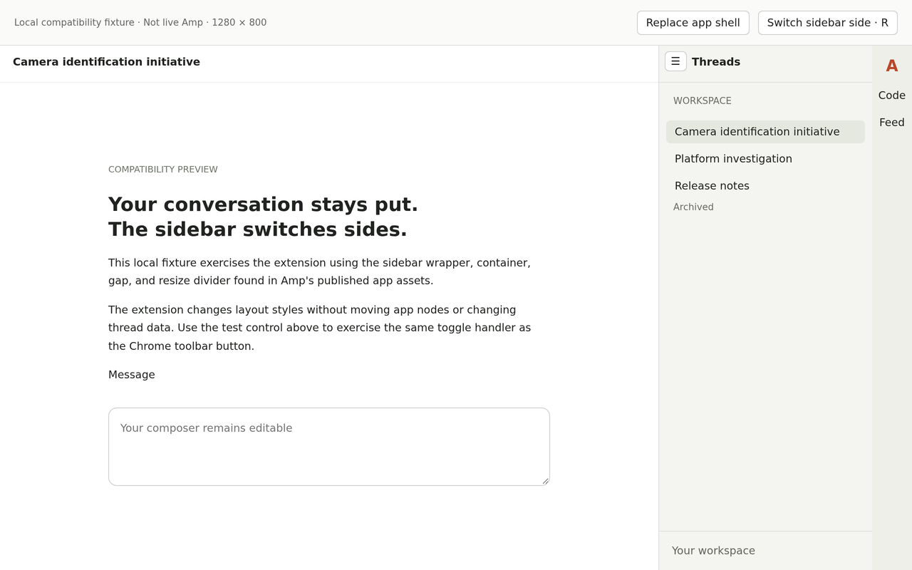
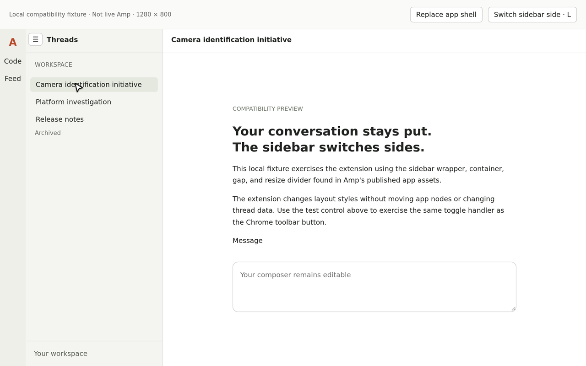

# Amp sidebar right

A dependency-free Chrome Manifest V3 extension for `https://ampcode.com`.
The desktop sidebar starts on the right. Click the extension's toolbar button
to switch between right and left. The R/L badge shows the saved side. The
choice applies to all open Amp tabs and survives browser restarts.

Independent project, not affiliated with or endorsed by Amp. The code is MIT licensed.
The Chrome Web Store release is in preparation, not published or approved.

## Install locally

1. Download the versioned ZIP from a repository release, or build it below.
   **Extract the ZIP** to a permanent folder. Do not select the ZIP in Chrome.
2. Open `chrome://extensions` in Chrome.
3. Turn on **Developer mode**.
4. Click **Load unpacked** and select the extracted folder that directly
   contains `manifest.json`. You can also load this cloned repository folder.
5. Pin **Amp sidebar right** from Chrome's Extensions menu.
6. Refresh any Amp tabs that were already open.

Click the pinned icon to switch sides. Drag the divider to resize the right
sidebar, or double-click it to restore Amp's width. Left mode restores Amp's
native layout and resize behavior. Right-mode width is saved separately.
In right mode, auxiliary views such as Files, Changes, Terminal, Desktop, and
Portal open to the left of the conversation. Their dividers still resize in
the direction you drag. Left mode restores their native placement on the right.
Child thread rows are indented by 20px per level in right mode, up to 64px,
using Amp's existing parent-child hierarchy without reordering threads.
To turn all extension behavior off or back on, click the **right-sidebar arrow icon**
in Amp's sidebar header. It stays available while behavior is off. You can also
right-click the extension's toolbar icon, choose **Options**, and toggle
**Enable extension behavior**. Both controls stay synchronized across open Amp
tabs and preserve your saved side and width.
When the current conversation has subagent activity, a **Subagents** button
appears in its header. Open it for an agent list with the selected task and
output below, on the opposite side from navigation. Files and Changes remain
open alongside it. Narrow desktop layouts use a drawer rather than squeeze
the conversation. Close the panel, press Escape inside it, or choose **View
original** to return to native inline activity.

The panel reads only subagent content already rendered by Amp, and keeps its
view in memory for the current thread. It does not save or transmit prompts
or results. Unloaded history is not fetched; unavailable content is identified
as such. Background tasks remain labeled **Delegated** until Amp exposes a
completion. Results with duplicate task descriptions appear separately rather
than risk attaching them to the wrong agent.

Below 768px, Amp's mobile layout is unchanged.
Disable or remove the extension, then refresh open Amp tabs to restore the
original page layout.

## Development preview

These are local compatibility fixtures based on Amp's published markup,
not screenshots of a signed-in Amp session and not Web Store listing images.

| Right sidebar | Left sidebar |
| --- | --- |
|  |  |

See the [feature screenshot catalog](store/screenshots/README.md) for
privacy-redacted live Helium captures and separately labeled fixture coverage.

## Scope and privacy

Only permission: `storage`, for the enabled state, side, and right-sidebar width on this device.
The content script runs only on `https://ampcode.com/*`. No network requests,
analytics, dependencies, or changes to thread data. This is an independent
extension, not an official Amp extension.

See the full [privacy policy](PRIVACY.md).

Chrome extensions work on Amp in Chrome and Chrome-installed PWAs. They
cannot modify the separate native Amp desktop app shown in the reference image.
Use Amp in Chrome for this extension.

## Build and test

No npm dependencies or bundler are required. Use Node.js 22+ and Python 3.12+.

```sh
node --check background.js
node --check content.js
node --check subagents.js
node --check options.js
node --test tests/background.test.mjs
python3 -m unittest discover -s tests -p '*_test.py'
python3 scripts/package.py
```

The build writes `dist/amp-sidebar-right-1.0.0.zip` and a SHA-256 checksum.
The manifest is at the ZIP root as required by the Web Store. Only runtime
files, icons, and the license are included, never tests or developer previews.
GitHub Actions runs syntax, toolbar behavior, and packaging checks on pushes
and pull requests, then uploads the build artifact. CI does not test live Amp.

To run browser fixture checks, install `agent-browser` and its Chrome runtime,
then start a static server from this repository:

```sh
python3 -m http.server 8765
```

In another terminal in this repository:

```sh
node tests/browser.mjs
```

The fixture's on-page toggle calls the actual service worker handler through
a mock Chrome API. It is not a control added to the live Amp page.

## Compatibility and verification

Selectors were checked against Amp's publicly served app assets on 2026-10-23.
Amp's layout is not a public API, so a future site update may require adjusting
`sidebar.css` or the divider selector in `content.js`.

Automated browser verification uses a local fixture based on the current app
markup. It covers switching sides, storage changes, resizing, collapse/reopen,
dynamic shell replacement, the mobile breakpoint, and subagent selection,
streaming text, completion, duplicate descriptions, and inline restoration.

The unpacked extension was also tested in a signed-in Helium session on
2026-10-24, including two real background subagents, their completed outputs,
both panel sides, Files coexistence, the narrow drawer, and the master switch.
Helium reported no extension manifest or runtime errors. Changes coexistence
is covered by the fixture suite; the live check does not cover every Amp view
or unloaded thread history. Recheck compatibility after Amp layout updates.

## Chrome Web Store release

- [Submission checklist and remaining gates](store/RELEASE.md)
- [Listing copy, privacy declarations, and reviewer instructions](store/listing.md)
- [Privacy policy](PRIVACY.md)
- [440 × 280 promotional tile](store/promo-small.png)
- [Feature screenshots and suggested upload order](store/screenshots/README.md)

Live, privacy-redacted 1280 × 800 captures are included. Finish the publisher
account requirements and privacy certifications in the Web Store dashboard.
Do not substitute the supplemental fixture images for real app screenshots.

The original icon shows a navy window frame, turquoise right sidebar, and coral
right-pointing arrow. It uses no Amp logo or wordmark. `store/icon-master.png`
is the raster master for the four runtime icons and promotional tile.
The Amp name identifies the compatible service and remains its owner's property.
